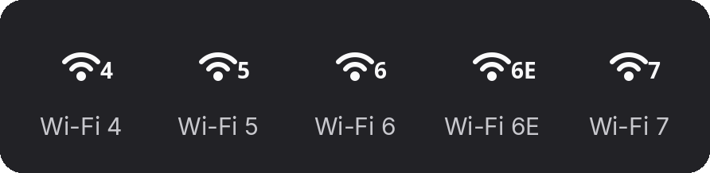
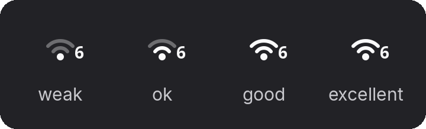

# Wi-Fi Generation Badge

GNOME Shell extension that puts the Wi-Fi generation on the top bar Wi-Fi icon itself, the one in the system menu. No extra indicator.


Shows `4`, `5`, `6`, `6E` or `7`. Hidden when you're on ethernet or not connected.



It rides along with the stock signal icon, whatever the strength.



## How it works

The generation comes from the link modulation in `iw dev <iface> link`: HT is 4, VHT is 5, HE is 6, EHT is 7. HE on 6 GHz shows as `6E`. It re-checks when the connection or signal changes, and every 30 seconds.

Needs `iw` (`sudo apt install iw` if it's missing) and NetworkManager.

## Install

From [extensions.gnome.org](https://extensions.gnome.org/), or from source:

```sh
git clone https://github.com/ponez/wifi-gen-badge.git
ln -s "$PWD/wifi-gen-badge" ~/.local/share/gnome-shell/extensions/wifi-gen-badge@ponez.github.io
```

Log out and back in (Wayland), then:

```sh
gnome-extensions enable wifi-gen-badge@ponez.github.io
```

## Compatibility

GNOME Shell 45 to 50. It hooks into the shell's network indicator internals, so a future GNOME release can break it.

## License

GPL-2.0-or-later
